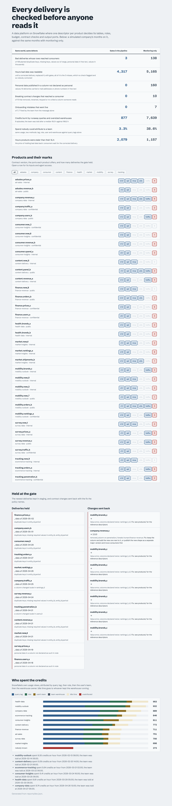

# data-product-control-plane

**A self-serve data platform on Snowflake and AWS where one YAML file per data product decides everything else:**
its tables and serving views, its roles and grants, its warehouse budget, the checks every delivery must pass
before anyone reads it, its catalogue entry and lineage, and the ports it is served on: REST, an MCP server, an A2A
agent and Kafka events.

Governance is computed, not reviewed. The rules are Rego, evaluated by OPA on every pull request and every access
request; data checks run in the warehouse between staging and publishing; cost is attributed from Snowflake's own
usage views every morning. Each rule's message names the field and the fix, so a domain team can onboard without
waiting on the platform team.



## Measured against a simulated company

`dpcp.world` simulates a business-data publisher's domain teams for four months: daily deliveries over S3 and Kafka,
derived products built from other teams' products, contract changes, new products, access requests from people,
services and AI agents, and Snowflake usage with runaway queries. Defects are planted at known rates and the truth is
kept apart. The same world runs against two designs:

* **Gates in the pipeline** (this platform): policies block on the pull request, deliveries are checked before
  publishing, cost is attributed and checked for anomalies each morning.
* **Monitoring only**: the same checks and policies run, but only raise alerts after the data or the change is live;
  spend is found when the monthly invoice is read.

<!-- results:start -->
| | Gates (dev) | Monitoring only (dev) |
|---|---:|---:|
| Bad deliveries whose rows reached consumers <br><sub>of 138 planted (duplicate keys, missing keys, values out of range, personal data in free text, values in thousands)</sub> | **3** | 138 |
| Hours bad data was readable <br><sub>until a corrected delivery replaced it; with gates, all of it is the 3 misses, which no check flagged and so nobody corrected</sub> | **4,317** | 5,165 |
| Personal data published in a column not declared as personal <br><sub>values; 10 deliveries carried e-mail addresses or phone numbers in free text</sub> | **0** | 160 |
| Breaking contract changes that reached a consumer <br><sub>of 13 that removed, renamed, retyped or re-united a column someone reads</sub> | **0** | 10 |
| Onboarding mistakes that went live <br><sub>of 7; 7 fixed by the team from the message alone</sub> | **0** | 7 |
| Credits burnt by runaway queries and oversized warehouses <br><sub>6 episodes; the team was told after a median 19.5 h against 198.0 h</sub> | **877** | 7,639 |
| Spend nobody could attribute to a team <br><sub>same usage, two methods: tag, role, user and warehouse against query tags alone</sub> | **3.3%** | 38.6% |
| Hours products were staler than their SLA <br><sub>the price of holding bad data back: consumers wait for the corrected delivery</sub> | **2,079** | 1,157 |

- **34 products** from 10 teams, 3,753 deliveries, 3,753 batches decided, 175 OPA evaluations.
- **Clean deliveries held by mistake:** 0 of 3,615.
- **Row-level quarantine:** 41 deliveries published their valid rows and held the rest, instead of holding the whole day.
- **Same rows through API, MCP and A2A:** 25 of 25 agent reads; products not offered to agents hidden from them: 20/20.
- **Kafka:** 3,659 events for 3,659 published batches, 3,659 distinct ids (sent from the outbox, marked only on delivery).
- **Files sent twice:** 35, loaded once each (35 skipped).
- **Freshness incidents:** 221, of which 171 paged a team; 212 went to the team that owned the cause (downstream products are linked to their upstream incident instead of paging their own team).
- **Cost attribution error per team and day:** 1.8% against 24.1% with query tags alone.
- **OpenMetadata:** 34 tables, 34 data products, 9 lineage edges; **Terraform:** 102 roles, 10 warehouses with resource monitors, 11 Kafka topics.
<!-- results:end -->

The held-out world (another seed, start date and team count) was run once after the code was frozen; see AGENTS.md.

## What it does

| | How | Where |
|---|---|---|
| **One descriptor per product** | identity, owner, classification, source, SLA, budget, ports, upstream inputs and an ODCS-style contract; validated by pydantic | `products/`, `descriptor.py` |
| **Policies as code** | Rego for products, contract changes and access, with `opa test` unit tests; Python only supplies facts | `policies/`, `policy.py` |
| **Breaking changes stopped before merge** | contract diff (removed, renamed, retyped, re-united columns, key changes) joined to the consumers that read each column; a new major version is a new table next to the old one | `contract.py`, `controlplane.py` |
| **Standard ingestion** | files and Kafka batches loaded once (path and SHA-256), staged per delivery, checked in SQL (required values, keys, ranges, personal data in undeclared columns, scale shifts against the last 14 days), then published in one transaction with its outbox event | `pipeline.py` |
| **Row-level quarantine** | row-scoped findings up to a configured share publish the valid rows and hold the rest, so a few bad rows do not make a whole product stale | `pipeline.py` |
| **Masking** | `pii: true` columns hashed in the serving view; the full view only inside the owning domain | `pipeline.py`, `policies/access.rego` |
| **SLAs and incidents** | freshness per product, checked hourly upstream-first; a stale product whose input is broken is linked to that incident and its team is not paged | `sla.py`, `incidents.py` |
| **Cost per team** | `QUERY_ATTRIBUTION_HISTORY` joined to query tags, role owners (from Terraform), the identity provider's groups and warehouse owners; idle time to the warehouse owner or pro rata; next-morning anomaly alerts | `cost.py` |
| **Output ports** | one `ProductService` behind REST, an MCP server (MCP Python SDK 2) and A2A (`/.well-known/agent-card.json`, JSON-RPC `message/send`); only products at or below `internal` with units on every number are offered to agents | `ports/` |
| **Kafka** | CloudEvents from the outbox, keyed by product, marked sent only on a delivery report; confluent-kafka with idempotence | `ports/events.py` |
| **Catalogue** | OpenMetadata domains, tables with PII and tier tags, data products and column-level lineage, all as idempotent PUTs | `catalog.py` |
| **Infrastructure** | Terraform: per-product roles and grants, per-team warehouses with resource monitors, the S3 storage integration and its IAM role, Kafka topics; `dpcp render` writes the inputs from the descriptors | `infra/`, `terraform.py` |

## Run it

```bash
pip install -e '.[dev]'                 # OPA 1.x on PATH as well: https://www.openpolicyagent.org/docs/#running-opa
pytest -q && opa test policies
dpcp check products/                    # what CI runs on a domain team's pull request
dpcp render products/                   # Terraform inputs
python3 scripts/evaluate.py             # both designs on the dev world (about 10 minutes on 2 cores)
python3 scripts/readme.py               # README results and web/public/data/console.json
cd web && npm ci && npm run dev         # the console
```

`config/platform.toml` holds every threshold. `[snowflake] mode = "account"` with `SNOWFLAKE_*` variables points
the same code at a real account.

## Decisions

See [docs/decisions.md](docs/decisions.md). The short version: rules in Rego so that domain teams, the platform
team and auditors read the same file; checks in the warehouse rather than in Python so that they scale with
Snowflake; a new table per major version so a breaking change never breaks a reader in place; one serving path for
every port so that an agent can never see more than a person with the same grant.

## Limits

* The numbers come from a simulation. The defect rates, team behaviour and Snowflake usage are assumptions in
  `config/world.toml`, not measurements of any company.
* Snowflake runs as fakesnow (the connector's API on DuckDB). Roles, grants, secure views, resource monitors and query
  tags exist only in the Terraform and are not exercised; see [docs/architecture.md](docs/architecture.md).
* OpenMetadata and Kafka are exercised against a recording HTTP transport and an in-memory producer, not live servers.
* The attribution baseline is query tags alone; teams that already map users to teams would start closer to the
  platform's number.

More: [architecture](docs/architecture.md) · [onboarding playbook](docs/onboarding-playbook.md) ·
[decisions](docs/decisions.md)
