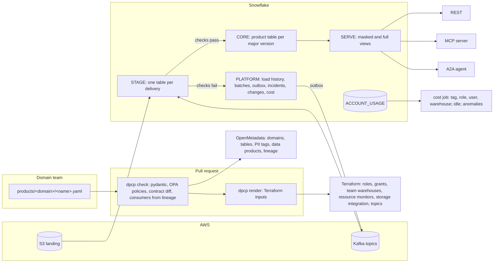

# Architecture

## Where each thing is decided

| Decision | Made by | Code |
|---|---|---|
| Is this descriptor acceptable? | Rego (`deny_product`) | `policies/product.rego` |
| May this contract change merge? | Rego (`deny_change`) on facts from the diff and the lineage | `policies/change.rego`, `contract.py` |
| May this principal read this product through this port, masked or not? | Rego (`deny_access`, `unmasked`) | `policies/access.rego` |
| May this delivery be published? | SQL checks in Snowflake, then the gate | `pipeline.py` |
| Who owns this incident? | lineage: the furthest upstream product with an open incident | `incidents.py`, `sla.py` |
| Whose credits are these? | ACCOUNT_USAGE joined to tag, role, user and warehouse owners | `cost.py` |

## Snowflake objects

* `CORE.<DOMAIN>__<NAME>_V<major>`: the product table. A new major version is a new table next to the old one,
  so consumers of v1 keep working while they move.
* `SERVE.<table>` hashes every `pii: true` column with SHA-256 (joinable, not readable); `SERVE.<table>__FULL` does not.
  Readers get one of the two through the roles Terraform creates (`_READER`, `_READER_FULL`); `policies/access.rego`
  grants the full view inside the owning domain only. In an account the views are `secure`.
* `STAGE.<table>__B<batch>`: one table per delivery; dropped after a full publish, kept when anything was held.
* `PLATFORM.*`: the platform's own records. Every decision is a row.

## What runs on the emulator, and what does not

Tests and the simulated world run on [fakesnow](https://github.com/tekumara/fakesnow), which is the Snowflake
Python connector's API on DuckDB. Tables, views, `MERGE`/`DELETE`/`INSERT`, `REGEXP_LIKE`, `MEDIAN`,
`TRY_PARSE_JSON(...):path` and `write_pandas` behave as in Snowflake there. Roles, grants, secure views, resource
monitors and `ALTER SESSION SET QUERY_TAG` do not exist on it: they are created by Terraform in an account
(`infra/`), validated in CI, and never applied here. The cost job reads tables with the shape of
`ACCOUNT_USAGE.QUERY_HISTORY`, `QUERY_ATTRIBUTION_HISTORY` and `WAREHOUSE_METERING_HISTORY`, written by the world.
